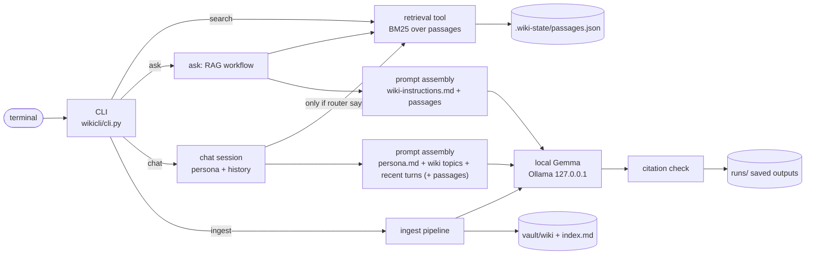

# IBD Personal Wiki: local Gemma + RAG

A command-line personal wiki built from my notes for UC Berkeley Haas's **International Business Development (IBD)** program. It runs fully offline with **Gemma 4 E2B** through Ollama on a MacBook Air (M3, 16 GB). The harness is my own ~2,000 lines of standard-library Python. There are three interaction modes:

- **chat**: a personal assistant ("Quill") with conversation memory. It looks up notes only when a turn needs them.
- **ask**: standalone factual answers from retrieved original passages, with checked citations or an explicit *insufficient evidence* reply.
- **search**: returns the original passages and their locations. No model is involved.

Other commands: **ingest** (sources → linked Obsidian notes), **lint** (checks the wiki), **eval** (runs the test set), **status**, and **help**.

| Start here | |
|---|---|
| CLI and harness code | [`wiki`](wiki) launcher → [`wikicli/`](wikicli) ([`cli.py`](wikicli/cli.py), [`modes.py`](wikicli/modes.py), [`retrieval.py`](wikicli/retrieval.py), [`llm.py`](wikicli/llm.py), [`ingest.py`](wikicli/ingest.py), [`citations.py`](wikicli/citations.py)) |
| Instructions loaded per mode | [`prompts/persona.md`](prompts/persona.md) (chat), [`prompts/wiki-instructions.md`](prompts/wiki-instructions.md) (ask), [`prompts/chat-router.md`](prompts/chat-router.md), [`prompts/ingest-instructions.md`](prompts/ingest-instructions.md) |
| Obsidian vault | [`vault/`](vault): [`index.md`](vault/index.md), [`Source Catalog.md`](vault/Source%20Catalog.md), [`wiki/`](vault/wiki), [`raw/`](vault/raw) |
| Four ask-mode evidence cards (offline) | [test1](evidence/ask-tests/test1.md) · [test2](evidence/ask-tests/test2.md) · [test3](evidence/ask-tests/test3.md) · [test4](evidence/ask-tests/test4.md) |
| Chat / search mode checks (offline) | [assessment](evidence/mode-checks/README.md) · [chat transcript](evidence/mode-checks/chat-offline.md) · [search output](evidence/mode-checks/search-offline.md) |
| Offline demonstration | [full terminal transcript](evidence/offline/transcript.txt) (Wi-Fi off, `curl` fails, runtime restarted, ingest → lint → search → 4 tests → chat → ask) · [screenshots](evidence/screenshots) |
| Wiki review and re-ingest tests | [evidence/wiki-review.md](evidence/wiki-review.md) |

---

## 1. Purpose and sources

**What the wiki is for:** a small, verifiable reference for how the IBD program works: the timeline, what is expected of team members and leads, travel, how to run the first client conversations, and how to set up a team. It should answer questions like "when is the application deadline?", "how many hours does a team lead commit?", and "how should we define success with the client and inside the team?".

| Original (unchanged, in `vault/raw/`) | What it is | Wiki pages generated from it |
|---|---|---|
| `IBD Info Session Spring 2026_Slides.pdf` (26 slides) | Program information session: schedule, deadlines, team roles, travel | [IBD Program Info Session](vault/wiki/Courses/IBD%20Program%20Info%20Session.md), [IBD Mechanics](vault/wiki/Concepts/IBD%20Mechanics.md), [Team Roles and Expectations](vault/wiki/Concepts/Team%20Roles%20and%20Expectations.md), [IBD Project Travel](vault/wiki/Concepts/IBD%20Project%20Travel.md) |
| `IBD Client Questionnaire.docx` | Template of sample questions for a first client conversation | [IBD Client Questionnaire](vault/wiki/Tools/IBD%20Client%20Questionnaire.md), [Central Strategic Challenge](vault/wiki/Concepts/Central%20Strategic%20Challenge.md), [Project Objectives and Outcomes](vault/wiki/Concepts/Project%20Objectives%20and%20Outcomes.md), [Market & Industry](vault/wiki/Concepts/Market%20%26%20Industry.md), [Customer Insights](vault/wiki/Concepts/Customer%20Insights.md) |
| `Teams@Haas Collaborative Plan .docx` | Team-design discussion template | [Teams@Haas Collaborative Plan](vault/wiki/Tools/Teams%40Haas%20Collaborative%20Plan.md), [Goal Alignment](vault/wiki/Concepts/Goal%20Alignment.md), [Team Climate](vault/wiki/Concepts/Team%20Climate.md), [Team Knowledge Coordination](vault/wiki/Concepts/Team%20Knowledge%20Coordination.md) |

**What I left out, and why.** My IBD folder also holds the client project I worked on (meeting notes, the problem statement, strategy frameworks, the final report). That material belongs to a real client and is confidential, so it is not in this public repository. Travel bookings (other people's personal data), my program application, and past teams' example reports for other clients are excluded too. Only general program materials remain. The copies in `vault/raw/` are byte-identical to the originals (SHA-256 recorded in the [Source Catalog](vault/Source%20Catalog.md)).

**How originals connect to pages.** Each original gets a stable machine ID (`src-ibd-client-questionnaire`) that is stored in note properties, never in filenames. It gets one **source note** named for its subject (e.g. `Tools/IBD Client Questionnaire.md`) and up to 4 **concept notes** in `Concepts/`. Every key point links back to the original, down to the PDF page (`[[raw/…Slides.pdf#page=8|… p.8]]`). The [Source Catalog](vault/Source%20Catalog.md) maps every original to its ID, hash, and notes.

## 2. Setup and device

| | |
|---|---|
| Computer | MacBook Air (Mac15,12), **Apple M3**: 8-core CPU (4 performance + 4 efficiency), 10-core GPU |
| Memory | **16 GB unified memory** (CPU and GPU share it; no dedicated VRAM). About 32% free system-wide while working (`memory_pressure`) |
| OS / disk | macOS 15.6.1 · 250 GB free |
| Runtime | **Ollama 0.34.4** (Homebrew, runs as a local service on `127.0.0.1:11434`) |
| Model | **`gemma4:e2b-it-qat`**: Gemma 4 E2B instruction-tuned, quantization-aware-trained **Q4_0**; 4.6B total parameters (≈2B effective per token plus embedding tables); 4.3 GB download; used with an 8,192-token context (max 128K) |
| Other tools | `pdftotext` from **poppler 26.09.0** (local PDF text extraction); **Python 3.9+ standard library only**: no pip packages, no embedding model (tested on 3.9.6 and 3.14.7) |
| Model source | Official Gemma docs: <https://ai.google.dev/gemma/docs/core> · Ollama library: <https://ollama.com/library/gemma4> (tag `e2b-it-qat`) |

### Install (online, once)

```bash
brew install ollama poppler
```

```bash
brew services start ollama
```

```bash
ollama pull gemma4:e2b-it-qat
```

```bash
git clone <this repo> && cd <repo> && ./wiki status
```

After this, everything runs offline. The weights live in `~/.ollama/models` and are not committed.

### Commands

```bash
./wiki --help
```

```bash
./wiki ingest vault/raw
```

```bash
./wiki search "team goals success"
```

```bash
./wiki ask "When is the IBD application deadline?" --mode local
```

```bash
./wiki chat
```

```bash
./wiki lint
```

```bash
./wiki eval
```

`ingest` also accepts one file, `--force` (regenerate unchanged sources), `--overwrite-reviewed`, and `--relink-all`. `search` accepts `-k 5` and `--scope raw|wiki|all`. `chat --script FILE` replays typed turns (used for the saved mode checks). Inside chat, `/notes <q>` forces a lookup, `/search <q>` shows passages, `/save [name]` writes the last reply to `drafts/` (outside the vault, never evidence), and `/history`, `/clear`, `/exit` do what they say. Errors are explicit: a stopped Ollama gives `error: local model unavailable: … Start it with ollama serve` (exit 3), and a missing file or folder gives `error: No such file or folder` (exit 2). `search`, `lint`, and `--help` work without the model.

### Why E2B, and measured cost on this Mac

The course guidance for a 16 GB Mac is "E2B or E4B". I chose the **smallest model that does the job**. Its answers are short extractions from 5 passages of at most 900 characters each, which does not need a bigger model. It also leaves room for the rest of the machine.

| Measurement (this Mac, this wiki) | Value | How measured |
|---|---|---|
| Model memory once loaded | **3.57–3.70 GB**, all on the GPU (`size_vram` = `size`); 3.57 GB in the offline run | Ollama `/api/ps` via `./wiki status` |
| Runtime process memory | **4.45 GB** RSS (`llama-server`) offline, plus 0.03 GB for `ollama serve`; about 28% of 16 GB | `ps` in the offline script |
| Ask answer time | **1.97–2.67 s** end to end offline with the model already loaded (the ingest step loads it about 30 s earlier); about 46 tokens/s | [offline evidence cards](evidence/ask-tests) |
| Ingest, 3 sources from scratch | **4 min 21 s** (about 24 Gemma calls: 4 extraction parts, 3 naming, 3 concept-selection, up to 14 link ratings) | [run2 log](evidence/ingest/run2-after-dedupe.txt) |
| Ingest, one source forced | **28 s** offline (client questionnaire) | [offline transcript](evidence/offline/transcript.txt) |

I did not run E4B. At 6.1 GB (QAT) it would still fit, but E2B already passes 3 of the 4 ask tests. The one partial failure (test 2) comes from PDF text extraction, not model size (see [Reflection](#7-reflection-a-real-limitation)).

## 3. Architecture



| Part | What it is here |
|---|---|
| **Model** | Gemma 4 E2B in Ollama. It only sees the messages the harness sends. It does not read files, remember past runs, or call tools. [`llm.py`](wikicli/llm.py) is the only code that talks to it, and it refuses any non-local URL in local mode ([`llm.py:34`](wikicli/llm.py:34)). |
| **Retrieval tool** | [`retrieval.py`](wikicli/retrieval.py) splits the originals (and generated notes) into passages that keep the path, section or page, and line range, then ranks them with BM25. No model is involved; `wiki search` shows its raw output. |
| **RAG workflow** | Ask mode: retrieve → drop weak hits → put the evidence and research rules in a prompt → Gemma answers → check citations. It supplies context at answer time; Gemma is not trained on anything. |
| **Harness** | Everything around the model: mode selection, which instruction file to load, conversation history, whether to retrieve, prompt assembly, model calls, citation checks, error messages, saved outputs, and ingestion. |
| **CLI** | [`cli.py`](wikicli/cli.py): argparse subcommands plus the `./wiki` launcher. |

### One question traced through the code: `./wiki ask "When is the IBD application deadline?"`

1. `./wiki` runs `python3 -m wikicli`, and [`cli.main`](wikicli/cli.py:92) parses `ask`, loads `config.json` through [`load_config`](wikicli/config.py:36), and calls [`run_ask`](wikicli/modes.py:68).
2. [`build_index`](wikicli/retrieval.py:152) loads `.wiki-state/passages.json`, or re-chunks the files if any file in `vault/raw` or `vault/wiki` changed (the file signature is compared).
3. [`index.search(question, kinds=("raw",))`](wikicli/modes.py:71) ranks only **original** passages. Generated notes, chat history, and saved answers are never evidence in ask. The top 5 are kept.
4. **Harness gate** ([`modes.py:72`](wikicli/modes.py:72)): passages scoring below 2.0 are dropped. If none remain, the harness returns *Insufficient evidence* without calling the model.
5. **Prompt** ([`modes.py:86`](wikicli/modes.py:86)): system = `prompts/wiki-instructions.md` (research rules, no persona); user = the passages labeled `[S1]…[S5]` with `file:lines (Page N)` headers, then the question. No chat history is included.
6. **Model call** ([`llm.chat`](wikicli/llm.py:72)): POST to `http://127.0.0.1:11434/api/chat` with temperature 0.2, `num_ctx` 8192, and thinking off. Tokens stream to the terminal.
7. **Citation check** ([`citations.check`](wikicli/citations.py:34)): every `[S#]` must be a retrieved label. Sentences without a citation are flagged, and word overlap between each cited sentence and its passage is printed as a hint for the human check.
8. **Saved output** ([`save_run`](wikicli/modes.py:115)): `runs/ask/<time>-<question>.md` and `.json` with the question, all retrieved passages and scores, the answer, the citation check, model, execution mode, and timing.

### Chat, search and ingest in the same terms

- **Chat** ([`ChatSession`](wikicli/modes.py:153)). The system prompt is `persona.md` plus a list of wiki topics taken from `index.md`, so Quill can describe what it can help with without retrieving anything. It keeps the last 6 turns, which are text only; retrieved passages are never stored in history.
- **Chat retrieval decision** ([`decide`](wikicli/modes.py:166)). Greetings, capability questions, and edit follow-ups ("make that shorter") skip retrieval by rule. Anything else goes to a small Gemma router with a JSON schema (`prompts/chat-router.md`) that returns `{retrieve, query}`. `/notes` forces a lookup. Each turn prints its decision (`[notes: not needed · …]`).
- **Chat citations.** If notes were retrieved, they are added for that turn only, labeled `[N#]`, and checked like ask citations. If nothing was retrieved, Gemma is told not to cite anything, and the harness warns if it does anyway (this happened in early testing).
- **Search** ([`run_search`](wikicli/modes.py:46)) stops after retrieval.
- **Ingest** ([`run_ingest`](wikicli/ingest.py:438)): read the original → split it into parts → Gemma extracts per part → Gemma names the source and picks concepts → write notes → Gemma rates candidate related notes → rewrite `index.md` and the Source Catalog → rebuild the index. All outputs from Gemma use JSON-schema structured output, so malformed output is retried and cannot break a note.

## 4. Design choices

- **Passages.** Split at headings, and PDFs split per page (`## Page N` is added during extraction, so citations name the slide). Each passage is then cut into windows of about 900 characters (≈200 tokens) with 150 characters of overlap, keeping whole lines. Ask sends at most 5 passages, about 4,500 characters or 1,200 tokens, well inside the 8K context.
- **Retrieval method.** BM25 with a small suffix stemmer. It is exact, explainable in `search` output, needs no second model, and is fast on 93 passages. The weakness is wording that doesn't match, which test 2 checks on purpose. It still found the right slide (page 8 at rank 2, behind the page-7 program overview), because "lead", "hours" and "week" appear on it.
- **Research rules** ([wiki-instructions.md](prompts/wiki-instructions.md)): cite every claim; exact insufficient-evidence sentence; answer every part of a multi-part question; treat questionnaire questions as "the source suggests asking…"; no general knowledge; neutral voice; no history. Rules 4 and 5 were added after test 3 failed (see [Results](#6-results-and-failures)).
- **Assistant personality** ([persona.md](prompts/persona.md)): Quill is warm, brisk, and honest about its limits. It lists only real abilities, labels drafts as suggestions, never invents personal facts, and treats chat claims as conversation rather than evidence.
- **Context limits.** Ingestion sends at most 6,000 characters (about 1,500 tokens) per call, with small pages grouped together (2 calls for the 26-slide PDF). Chat sends the persona, the topic list, 6 turns, and up to 4 passages.
- **Note naming and folders.** Filenames are the subject in 2–6 words and match the first heading (`Team Roles and Expectations.md`). Folders are `Courses/` (the program), `Tools/` (templates), and `Concepts/`. The harness cleans model titles: it strips file extensions, "Notes"/"Overview" suffixes, and unsafe characters. It drops concepts that are just the source's own subject (e.g. "IBD", "International Business Development Program"), and adds a meaningful qualifier (`Name - Folder`) instead of a random suffix when two subjects clash.
- **Re-ingestion without duplicates.** Unchanged originals (same SHA-256) are skipped. Changed ones update the note found by `source_id` in its properties, even if you renamed it in Obsidian. Concepts merge into an existing note matched by name, alias, or a contained name from the same source. Harness-owned sections sit between `<!-- wiki:…:start/end -->` markers and are replaced, never appended. Notes marked `reviewed: true` are protected. Evidence: [re-ingest logs](evidence/wiki-review.md#ingestion-history).
- **Model settings that mattered.** Temperature 0.1 for JSON, 0.2 for ask, and 0.7 for chat. Thinking is off (`think: false`); the model defaults to a thinking mode, which these short extraction answers don't need. I did not benchmark it on. Structured JSON output is used for every ingestion call. For related notes, a small model scores better when it **explains the shared subject first and scores 0–3 second**. Asking it to pick links directly produced either forced cross-topic links or none at all.

## 5. The wiki in Obsidian

Open **`vault/`** itself as the vault, not the repository. The graph settings are included in `vault/.obsidian/graph.json`: filter **`path:wiki/`**, attachments hidden, orphans hidden, and colors by folder (Courses, Tools, Concepts).

| Screenshot | File |
|---|---|
| An open note with its heading, source references, and related-note links | [evidence/screenshots/1-note.png](evidence/screenshots/1-note.png) |
| The page list / `index.md` grouped by topic | [evidence/screenshots/2-index.png](evidence/screenshots/2-index.png) |
| Graph view, filter `path:wiki/` | [evidence/screenshots/3-graph.png](evidence/screenshots/3-graph.png) |

**One trace through the wiki:** [index.md](vault/index.md) → *Tools* → [IBD Client Questionnaire](vault/wiki/Tools/IBD%20Client%20Questionnaire.md) → concept [Project Objectives and Outcomes](vault/wiki/Concepts/Project%20Objectives%20and%20Outcomes.md) → related note [Goal Alignment](vault/wiki/Concepts/Goal%20Alignment.md) ("the client's view of success here, the team's own measurable goals there") → its *Original* link opens `raw/Teams@Haas Collaborative Plan .docx`, where the NOTE line says team goals should be "challenging, consequential, and measurable".

`./wiki lint` checks what a reader would click. It confirms every `[[link]]` resolves to a note, a raw file, a Markdown heading, or a real PDF page, and that headings match filenames. It also flags machine-style names, duplicates, and notes without a source. Current result: 13 notes, 140 links, no problems. The corrections made during review are in [evidence/wiki-review.md](evidence/wiki-review.md).

## 6. Results and failures

Written before running, in [`evals/questions.json`](evals/questions.json), outside the vault so the answer key is never retrieved: three answerable questions (direct, paraphrased, two-source) and one the sources cannot answer (the word "grade" appears in none of them).

**Offline run (Wi-Fi off, runtime restarted):** see the [evidence cards](evidence/ask-tests) and the [transcript](evidence/offline/transcript.txt). The results table is filled in from that run below.

**Offline run: 2026-09-29 22:48–22:50.** Wi-Fi power off, `curl https://www.google.com` failed, the harness's own network check said `offline`, and Ollama was restarted before any command. Transcript: [evidence/offline/transcript.txt](evidence/offline/transcript.txt).

| Test | Question | Retrieval (expected source rank) | Actual Gemma answer (offline) | Citations checked by hand | Result |
|---|---|---|---|---|---|
| [1 direct](evidence/ask-tests/test1.md) | When is the IBD application deadline? | slides p.7 at rank 1 | "The IBD application deadline is October 8 [S1, S2]." | p.7 "Oct 8: IBD application deadline", p.16 "Oct 8: Applications due" | ✅ pass |
| [2 paraphrased](evidence/ask-tests/test2.md) | If I lead an IBD team, how many hours a week should I plan to spend on it? | slides p.8 at rank 2 | "A Team Lead should plan to spend 10-12 hours per week on the IBD program, which includes class time and client calls [S2]." | 10–12 h ✔; "includes class time and client calls" belongs to the **member** column ✘ | ⚠️ partial fail |
| [3 two-source](evidence/ask-tests/test3.md) | How should a consulting team define success, both with the client and within the team itself? | Teams@Haas rank 2, Questionnaire rank 3–4 | Team goals "evaluated and measured over time to determine whether success criteria are being met [S2]"; "the client questionnaire asks what success would look like at the end of a project [S4]." | both supported, both sources cited | ✅ pass (thin) |
| [4 unsupported](evidence/ask-tests/test4.md) | How is the IBD course graded? | 5 weak passages, none about grading (the model was still called) | "Insufficient evidence: the wiki sources do not contain information that answers this question." | n/a | ✅ pass |

Ask response time offline: **1.97–2.67 s** (about 46 tokens/s), with the model already loaded by the ingest step. Model memory during the run: **3.57 GB** (Ollama `/api/ps`, all on the GPU) and **4.45 GB** `llama-server` RSS. Offline Gemma ingestion of the questionnaire (forced, on a scratch copy): **28 s**, no new or duplicate notes, lint clean.

**Mode checks (offline):** 5 of 6 passed; the chat draft-with-citations check **failed** in this run. Details and cause: [evidence/mode-checks/README.md](evidence/mode-checks/README.md).

**What changed along the way.** Earlier results are kept.

| Version | Test 1 | Test 2 | Test 3 | Test 4 | Evidence |
|---|---|---|---|---|---|
| v1 (online practice) | ✅ Oct 8, pages 7 & 16 | ⚠️ 10–12 h correct, but says "includes class time and client calls" (that is the member column) | ❌ cited only Teams@Haas; the retrieved questionnaire passage (rank 3) was ignored | ✅ insufficient | [v1 cards](evidence/ask-tests-v1-before-fix) |
| change | | | Added research rules 4 (answer every part) and 5 (questions in a template are evidence of what to ask). 3/3 reruns then cited both sources. Also made the automatic check stricter: all expected sources must be cited (v1's check had wrongly passed test 3). | | [rules v1](evidence/ask-tests-v1-before-fix/wiki-instructions-v1.md) → [current](prompts/wiki-instructions.md) |
| v2 (online dry run of the offline script) | ✅ | ⚠️ same wrong qualifier | ✅ both sources cited | ✅ | [v2 cards](evidence/ask-tests-v2-online-dryrun) |

**Mode boundaries** (in [chat transcript](evidence/mode-checks/chat-offline.md), [search output](evidence/mode-checks/search-offline.md), [assessment](evidence/mode-checks/README.md)):

- ✅ "what can we do?" / "what can you help me with?": no notes lookup, no citations, no insufficient-evidence reply. Quill lists its real abilities and names wiki topics.
- ❌ An agenda draft for a first client meeting triggered a lookup (4 passages), but the reply cited none of them and borrowed the team-coordination template instead of the client questions. The harness flagged "16 sentences without a citation". It passed with `[N4]` in the online practice run; the cause (a title-only passage outranking the real questions, plus sampling at temperature 0.7) and fixes are in the assessment.
- ✅ "make that shorter" used the conversation without a lookup.
- ✅ "the deadline was moved to October 20" was said only in chat; the separate `wiki ask` afterwards still answered October 8 from the slides. Chat claims never reach ask.
- ✅ `wiki search "team goals success"` printed the original passages with `file:lines (section)` and scores, and no answer.

## 7. Reflection: a real limitation

**Failure: test 2 answers with the right number and the wrong qualifier.** Asked how many hours a team *lead* commits, Gemma answers "10-12 hours per week, which includes class time and client calls [S2]". The slide gives 10–12 h for leads, but "(including class time and client calls)" is written under the *member* column's 8–10 h. The citation points to the right slide, so a quick check would pass it; only reading the slide shows the error.

**Cause.** Slide 8 is a two-column table. `pdftotext -layout` keeps columns side by side on the same text line (`● 8-10 hours/week (including class time  ● 10-12 hours/week`), so in the passage Gemma sees, the qualifier looks attached to both numbers. The same splice produced the wrong "Team Member Expectations" note during ingestion; I corrected that note by hand, but ask reads the originals, so the answer still shows the problem. It is an extraction problem that the model then repeats faithfully, which is why stricter prompting didn't fix it.

**Improvement I would try next.** Column-aware PDF extraction: use `pdftotext -bbox-layout` word coordinates to split each slide into columns before chunking, so "Team Member Expectations" and "Team Lead Expectations" become separate passages. Gemma 4 E2B also accepts images, so a second option is to render each slide as an image during ingestion and ask Gemma to transcribe it into Markdown bullets, keeping the text version for search. I would rerun test 2 and the related ingestion to confirm.

**Other limitations seen.** In the offline chat check, a draft that used retrieved notes cited none of them (see [mode checks](evidence/mode-checks/README.md)): the harness flags it but does not yet repair it. BM25 needs shared words, so a question phrased with none of the slide's words would miss. E2B names concepts differently between runs; the harness now merges these, but a new synonym could still slip through, and `wiki lint` plus review catches it. Chat accepts "the deadline moved" as a conversational note instead of checking the wiki. It is never used as evidence, but a stricter assistant would look it up and point out the conflict.

## 8. Online mode

Not implemented. `--mode` accepts only `local`, and [`llm.py`](wikicli/llm.py:34) refuses any model URL that is not localhost. No hosted model, hosted embeddings, or remote search is used anywhere.

## Repository layout

```
wiki                    CLI launcher
wikicli/                harness: cli, config, llm (Ollama), retrieval (BM25), ingest, notes,
                        modes (search/ask/chat), citations, evals, lint, records, env
prompts/                instructions loaded per mode (persona, research rules, router, ingest)
config.json             model, runtime URL, chunk sizes, top-k, thresholds
vault/                  the Obsidian vault: raw/ originals, wiki/ notes, index.md, Source Catalog.md
evals/                  test questions + chat check script (outside the vault)
evidence/               evidence cards, transcripts, ingest logs, review log, screenshots
runs/                   every saved ask/search/chat/ingest output (JSON + Markdown)
scripts/offline_demo.sh the offline demonstration
tools/                  record of the one-off review pass
.wiki-state/            retrieval passage cache (machine file, rebuilt automatically; not committed)
```
